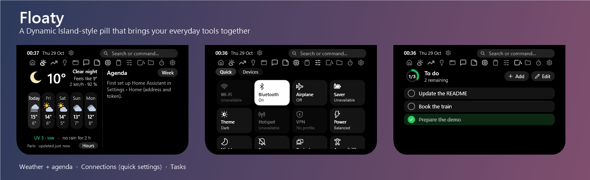

<p align="center">
  
</p>

<p align="center">
  
  
  
</p>

# Floaty

A **pill** in the style of the iPhone's Dynamic Island, stuck to the top of your screen (or to any other edge). Closed, it shows the time, the music that is playing, or a mascot; on hover it springs open and gives you access to about fifteen modules: media, timer, water tracker, tasks, notes, weather, agenda, system resources, clipboard, stocks, home automation, Discord, AI chat… It can even **replace the Windows taskbar**.

> The interface is available in **English and French**: Settings › General › Language (the default, "Auto", follows the Windows language). The screenshots show the English version.

## Contents

- [Overview](#overview)
- [Features](#features)
- [Usage](#usage)
- [Taskbar replacement](#taskbar-replacement)
- [Screen edges](#screen-edges)
- [Themes](#themes)
- [Installation](#installation)
- [Repository layout](#repository-layout)
- [Data and privacy](#data-and-privacy)

## Overview

All screenshots are taken with demo data (fake windows, sample tasks, Paris weather).

<table>
  <tr>
    <td width="50%"><br><b>Home</b>: clock, mascot and the music that is playing.</td>
    <td width="50%"><br><b>Weather + agenda</b>: conditions, forecast, UV, rain; upcoming appointments.</td>
  </tr>
  <tr>
    <td><br><b>Connections</b>: Wi-Fi, Bluetooth, airplane mode, Windows theme, hotspot, VPN, power mode… like the Windows quick settings.</td>
    <td><br><b>Resources</b>: live CPU, memory, GPU and disk usage, with network throughput and latency.</td>
  </tr>
  <tr>
    <td><br><b>Tasks</b>: to-do list with due dates and reminders.</td>
    <td><br><b>Notes</b>: quick notes, can be pinned in the pill.</td>
  </tr>
  <tr>
    <td><br><b>Timer</b>: progress ring, presets, Pomodoro.</td>
    <td><br><b>Water</b>: daily goal, "+ bottle" button, hourly histogram.</td>
  </tr>
  <tr>
    <td><br><b>Stocks</b>: followed stocks and cryptocurrencies, charts, price alerts.</td>
    <td><br><b>AI chat</b>: Claude, OpenAI, OpenRouter or any compatible service.</td>
  </tr>
  <tr>
    <td><br><b>Windows</b>: open windows and pinned applications, as tiles or a list.</td>
    <td><br><b>Shelf</b>: drop files on the go; one-click screenshots.</td>
  </tr>
</table>

Every page and every settings section is documented with its screenshot in [`windows/SCREENS.md`](windows/SCREENS.md).

## Features

- **A living pill**: closed size and content are up to you (mascot, time, media, timer, water, tasks, battery, weather, next appointment, stocks, CPU/RAM); it springs open and its content fades in as a cascade.
- **Watermelon mascot**: it breathes, blinks, dances to the music, falls asleep when the PC is idle, and reacts to a finished timer, a notification or a glass of water.
- **One single size**: the open pill keeps the same size on every tab; related modules are grouped (weather + agenda, timer + water, connections).
- **Media**: now playing (cover art, controls, lyrics); the accent colour can follow the cover art, the wallpaper or the active application.
- **Productivity**: tasks with reminders, notes, a file shelf, clipboard history, and application and command search from the header bar.
- **System**: live resources, volume and brightness, Windows-style quick settings, Windows notifications shown in the pill.
- **Connected**: weather (Open-Meteo), agenda and home automation (Home Assistant, IKEA hub), stocks and crypto, Discord (voice call), streaming AI chat.
- **Multiple monitors**: one pill per screen, each with its own icon bar.
- **Smart hiding**: the pill steps aside when an application goes full screen.

## Usage

| Gesture | Effect |
|---|---|
| Hover the pill | Opens it; it closes again when the mouse leaves |
| Horizontal wheel (or Shift + wheel) | Switches between tabs |
| Type in the "Search or command…" bar | Searches applications, files and commands |
| Cog next to the title | Opens the settings of the current module |
| Click a taskbar icon | Activates or launches the application |
| Right-click / middle-click an icon | Taskbar menu / new instance or close |
| Drag an icon | Reorders the icons in the bar |

## Taskbar replacement

Pinned applications and open windows sit on either side of the closed pill (or on its right, or on its left, or in a column along an edge). Icons are crisp, resizable and reorderable by drag and drop, with window previews on hover (including several instances of the same application) and a right-click menu. The Windows taskbar itself can be hidden from the settings.

<p align="center"></p>

## Screen edges

The pill can be attached to the top, bottom, left or right edge. On a side edge it becomes a vertical tab with the mascot and opens on hover; the taskbar icons then line up in columns above and below it.

<p align="center"></p>

## Themes

Dark, light, system and glass, plus eight moods (matching background and accent): **Night, Paper, Watermelon, Neon, Ocean, Forest, Sakura, Terminal**. The black level, the white level and the glass transparency can be fine-tuned.

<p align="center"></p>

<sub>Left to right, top to bottom: Dark, Light, Glass, Night, Paper, Watermelon, Neon, Ocean, Forest, Sakura, Terminal.</sub>

## Installation

### Windows

Requirements: Windows 10 or 11, the [.NET 8 SDK](https://dotnet.microsoft.com/download/dotnet/8.0) to build, and the .NET 8 runtime to run the executable. From the [`windows/`](windows/) folder, `publish.bat` produces a single executable, `dist\Navbar.exe`:

```bat
publish.bat
```

Or by hand:

```powershell
dotnet publish src\Navbar.csproj -c Release -r win-x64 --self-contained false -p:PublishSingleFile=true -o dist
```

Then just run `dist\Navbar.exe`; quit the application from the notification area ("Quit"). It does not require administrator rights. Every page and setting is detailed in [`windows/SCREENS.md`](windows/SCREENS.md).

### Linux (GNOME Shell)

The Linux version is a **GNOME Shell extension** (GJS): pill, clock, mascot, volume, media (MPRIS), weather, tasks, notes and water tracker, global shortcut (`Super` + `Ctrl` + `Space`) and full-screen hiding. The other modules of the Windows version are not ported yet. Installation and limitations: [`linux/README.md`](linux/README.md).

## Repository layout

| Folder | Contents |
|---|---|
| [`windows/`](windows/) | Windows version: native C# / .NET 8 / WPF application and the [visual reference of the screens](windows/SCREENS.md) |
| [`linux/`](linux/) | Linux version: GNOME Shell extension |
| `img/` | Screenshots used by this README |

## Data and privacy

Everything is local, in `%AppData%\Navbar` on Windows (settings, tasks, notes, shelf). API keys, tokens (Home Assistant, IKEA hub, Discord, bot…) and AI chat conversations are encrypted with the Windows account (DPAPI); none of this is in this repository. External services are only contacted if you enable the matching module (weather, stocks, AI chat…).
