# Visual reference: screens and settings

Screenshots of the Windows version, taken with a fresh profile (default settings) and demo data, to serve as a reference for the Linux version. The images are in [`../img/`](../img/). The interface is available in English and French (Settings › General › Language); the screenshots are the English version.

Common frame: the open pill has **a single size** (420 × 268 units, scaled by the Size, Width and Height settings). It contains:

- **Header:** time and date on the left, a "Search or command…" bar on the right. Typing in the bar shows the results in place of the current page.
- **Tab row:** one icon per module, all on a single line; the active page is coloured with the accent. The horizontal wheel (or Shift + wheel) moves from one tab to the next.
- **Page content**, which slides and fades in as a cascade when the tab changes.

Default tab order: Home, Weather + Agenda, Stocks, Home automation, Discord, Windows, AI chat, Notes, Resources, Clipboard, Connections, Controls, Tasks, Shelf, Timer + Water, Settings. Modules can be hidden and reordered.

## Closed pill

Content chosen in Settings › Pastille (pill): mascot, time, current media, timer, water, tasks, battery, weather, pinned note, next appointment, stocks, CPU/RAM. It takes the height of the icon bar when the bar is taller. On hover it opens (spring animation), and it can be attached to any edge of the screen.

## Pages

| Page | Screenshot | Content |
|---|---|---|
| **Home** | 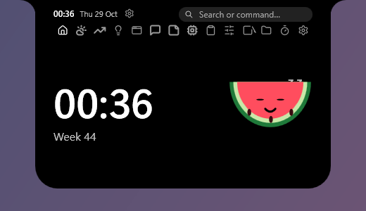 | Large clock (digital, words, analogue…), week number, mascot. When media is playing: cover art, title, artist, progress bar, controls, lyrics. During a Discord call: call controls. |
| **Weather + Agenda** | 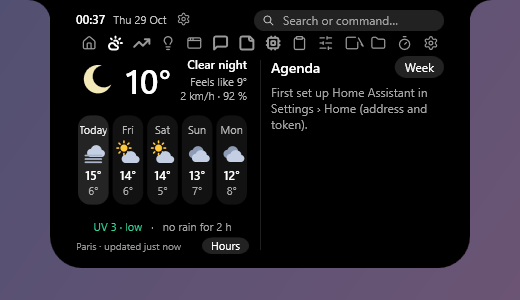 | Two halves separated by a line. Weather: condition and temperature, feels-like, wind, humidity, five forecasts (days or hours), UV, rain, Hours/Days button. Agenda: upcoming appointments (Home Assistant), Week button. |
| **Stocks** | 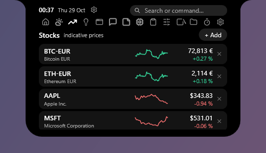 | Indicative prices with chart and change, "+ Add" button (search by name or symbol), price alerts. |
| **Home automation** | 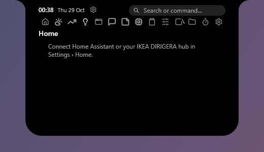 | Smart home (Home Assistant, IKEA hub): devices by room, routines, "turn everything off" button. |
| **Discord** | 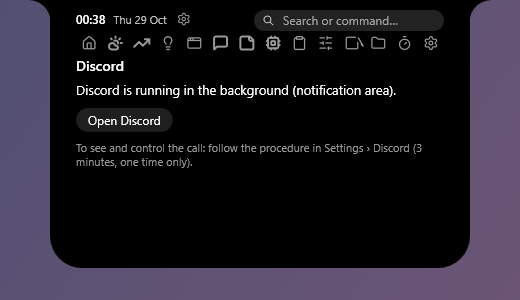 | Voice call controls: mute, deafen, volumes, servers and channels. |
| **Windows** | 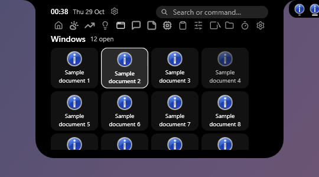 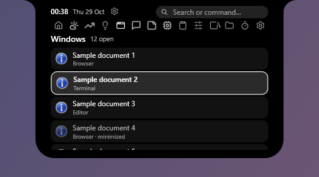 | Open windows and pinned applications, as tiles or a list; click: activate or launch, right-click: menu, middle-click: new instance or close. |
| **AI chat** | 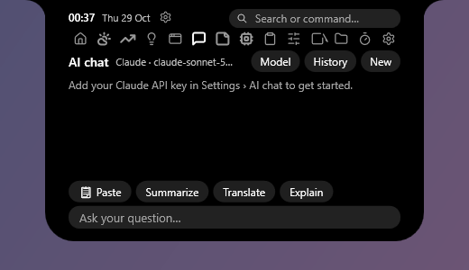 | Streaming conversation (Claude, OpenAI, OpenRouter or compatible), history, model, shortcuts Paste / Summarise / Translate / Explain. |
| **Notes** | 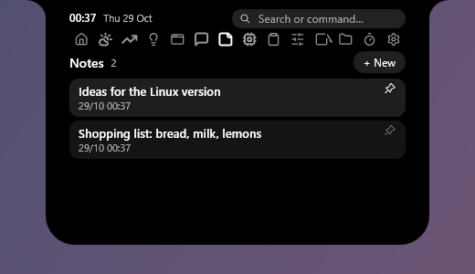 | Quick notes, pinnable (can be shown in the pill). |
| **Resources** | 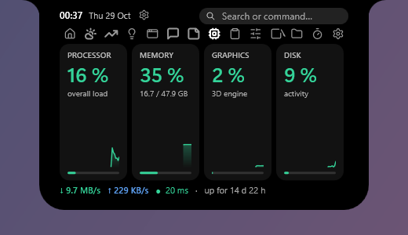 | CPU, memory, GPU, disk (percentage, chart, bar), then throughput, latency and uptime. Option: top processes. |
| **Clipboard** | 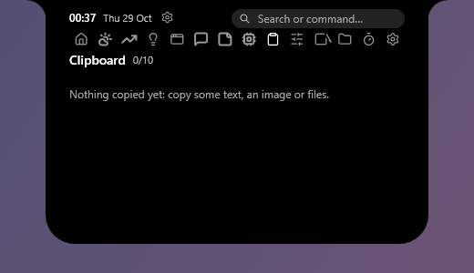 | Last ten copies (text, images, files), click to copy again. |
| **Connections** | 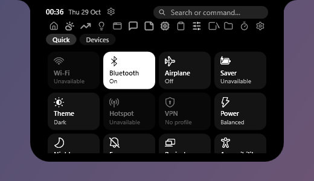 | Windows-style quick settings: Wi-Fi, Bluetooth, airplane mode, battery saver, light/dark theme, hotspot, VPN, power mode, night light, focus, project, accessibility, nearby sharing; volume and brightness below. Second page "Devices": batteries, Bluetooth and Wi-Fi lists. |
| **Tasks** | 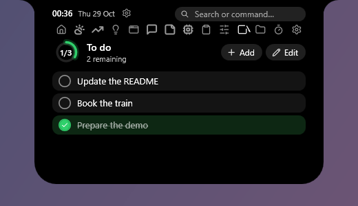 | List with check boxes, due dates, reminders, remaining-tasks counter. |
| **Shelf** | 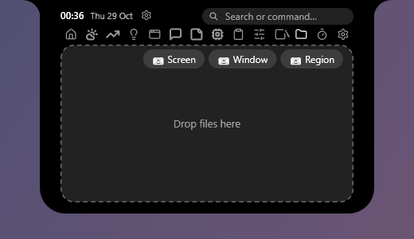 | File drop zone; screenshot buttons (Screen, Window, Region). |
| **Timer + Water** | 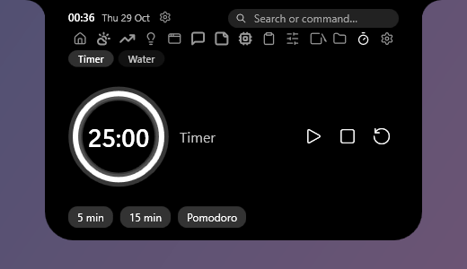 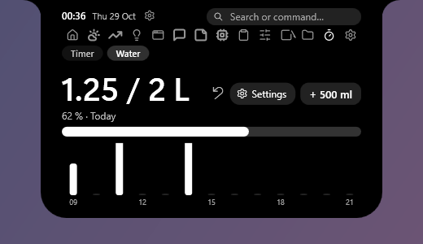 | Timer: progress ring, presets (5 min, 15 min, Pomodoro). Water: today's total against the goal, "+ bottle" button, undo, hourly histogram. A selector switches between the two. |
| **Settings** |  | Scrolling strip of sections, then the options of the selected section (see below). |

## Settings

One section per module, in this order. Every module page also has a cog that leads straight to its section.

| # | Section | Screenshot |
|---|---|---|
| 0 | Appearance | 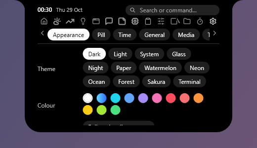 |
| 1 | Pill | 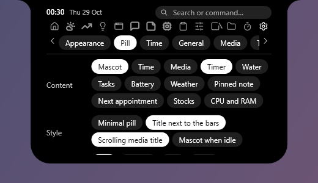 |
| 2 | Time | 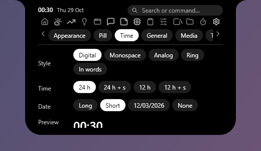 |
| 3 | General | 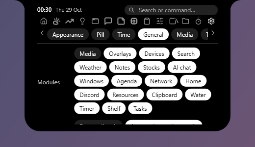 |
| 4 | Media | 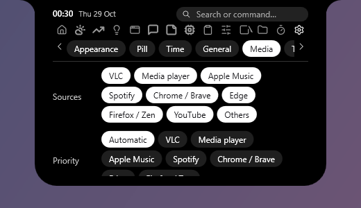 |
| 5 | Timer | 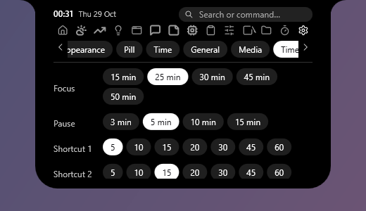 |
| 6 | Water | 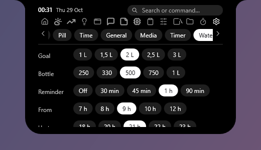 |
| 7 | Tasks | 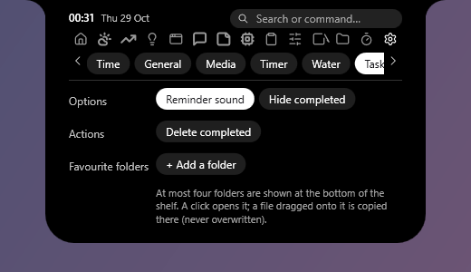 |
| 8 | Shelf | 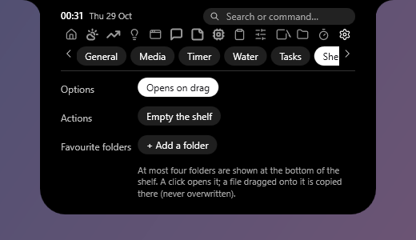 |
| 9 | Sound | 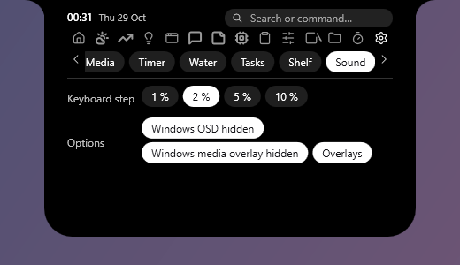 |
| 10 | Devices | 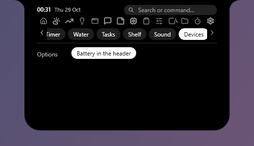 |
| 11 | Search | 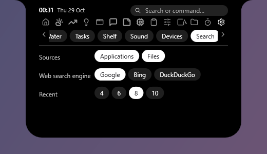 |
| 12 | Clipboard | 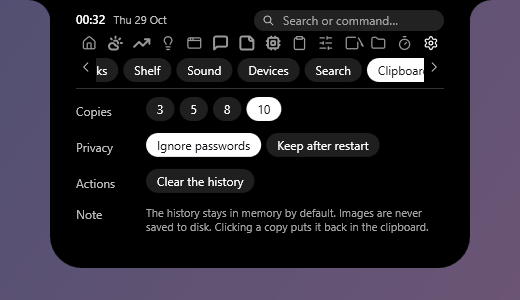 |
| 13 | Resources | 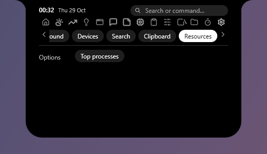 |
| 14 | Weather | 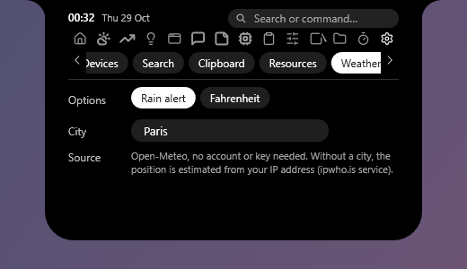 |
| 15 | Stocks | 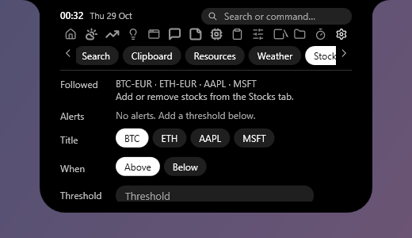 |
| 16 | AI chat | 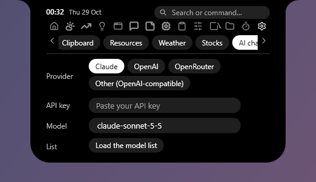 |
| 17 | Discord | 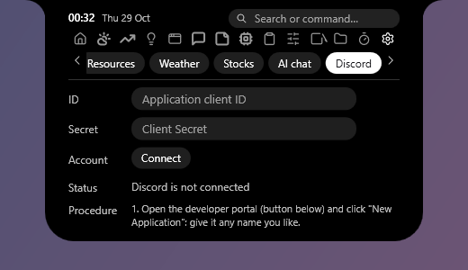 |
| 18 | Home automation | 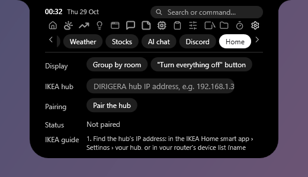 |
| 19 | Network | 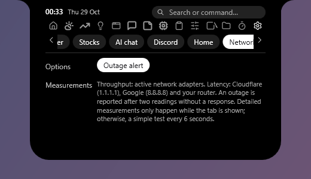 |
| 20 | Agenda | 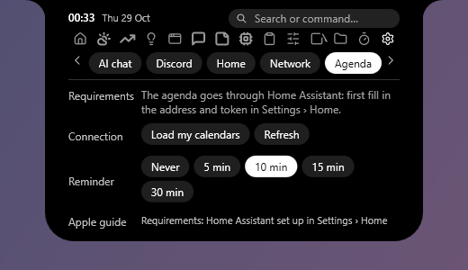 |
| 21 | Windows | 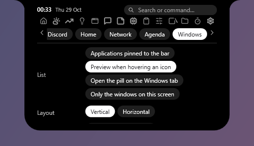 |

The screenshots show the top of each page; long pages scroll with the mouse wheel.

## Replacement taskbar and screen edges

 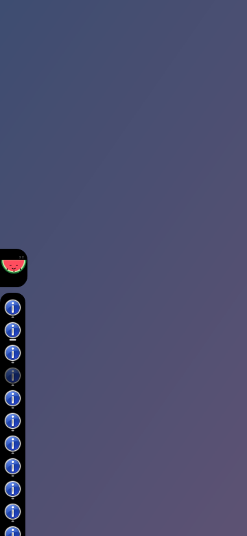

Icon bar on the right, on the left, or split on either side of the pill (or in a column along an edge); resizable, reorderable by drag and drop, with window previews on hover and a right-click menu. The pill attaches to the top, bottom, left or right edge; on a side edge it becomes a vertical tab.

## Themes

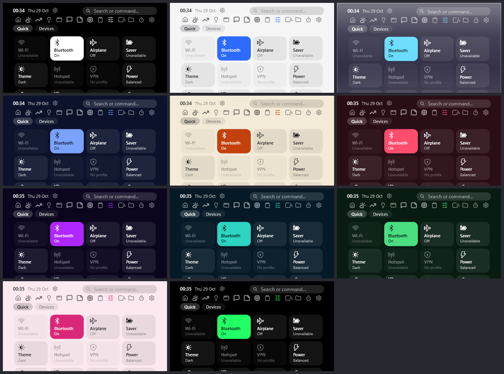

Dark, Light, System, Glass, Night, Paper, Watermelon, Neon, Ocean, Forest, Sakura, Terminal (each mood has its own background and accent).

## Not photographed

The media that is playing (cover art, controls, lyrics), the overlays (volume, brightness, notifications), the "Devices" page (real device names) and the connected states of Discord, home automation and the agenda could not be captured with demo data.
